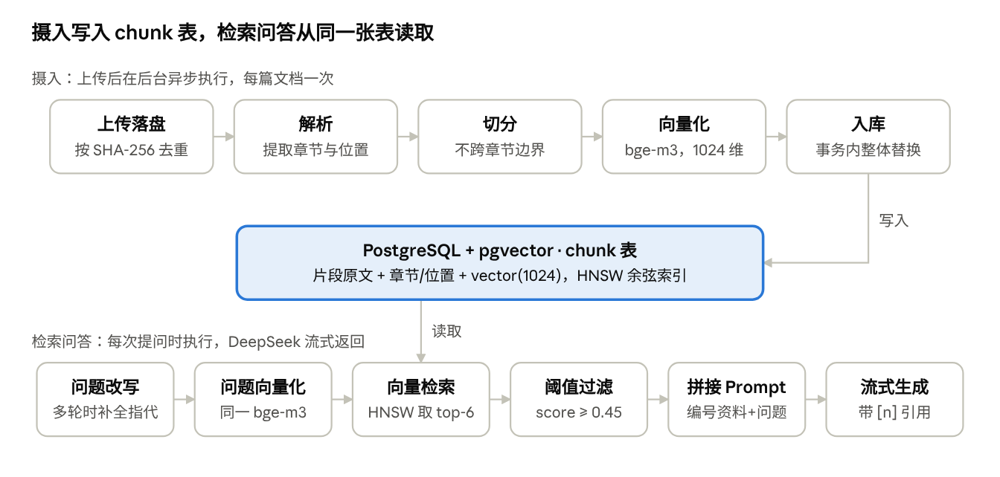

# 超级知识库：文档摄入与检索问答实现说明

2026-10-15

## 概述

系统有两条核心链路：**摄入**把上传的 Word / Excel / PPT / PDF 变成带出处信息的向量片段，存进 PostgreSQL；**检索问答**把用户问题变成向量，在同一个库里召回最相关的片段，拼成带编号的参考资料交给 DeepSeek 流式回答，并要求标注 `[n]` 引用。

两条链路共用同一个 embedding 模型（Ollama 本地 bge-m3，1024 维）和同一张 `chunk` 表：摄入写、检索读。向量和业务数据都在 PostgreSQL（pgvector 扩展）里，没有独立的向量数据库。



上排每篇文档执行一次，下排每次提问执行一次；两条链路通过 `chunk` 表和同一个 bge-m3 模型衔接。

| 环节 | 代码位置 | 外部依赖 |
| --- | --- | --- |
| 上传、去重、文件存储 | `document/DocumentController`、`DocumentService`、`FileStorage` | 本地磁盘 `./data/files` |
| 异步调度、向量化、入库 | `ingestion/IngestionService`、`ChunkRepository` | Ollama bge-m3、PostgreSQL |
| 解析 | `ingestion/DocumentParser`、`TikaBlockHandler` | Apache Tika 3 |
| 切分 | `ingestion/Chunker` | 无 |
| 问题改写、拼接 Prompt、流式生成 | `chat/ChatController`、`ChatService` | DeepSeek API |
| 向量检索与召回过滤 | `retrieval/Retriever` | Ollama bge-m3、PostgreSQL |

技术栈：Spring Boot 4 + Spring AI 2、Apache Tika 3、PostgreSQL 17 + pgvector；持久层用 `JdbcClient` 手写 SQL，表结构由 Flyway 管理。下文代码均摘自仓库当前版本，略去了与主流程无关的部分。

## 摄入一：上传、去重与异步调度

上传接口只负责「落盘 + 登记」，立即返回；解析、切分、向量化都在后台线程池里异步完成，前端通过轮询文档状态看进度。

**入口**：`POST /api/knowledge-bases/{kbId}/documents`，multipart 字段名 `files`，可一次传多个文件。单文件上限 200MB、单次请求 1GB（`spring.servlet.multipart`）。每个文件单独返回结果：`ACCEPTED` / `DUPLICATE` / `REJECTED`，一个文件失败不影响同批其他文件。

`DocumentService.uploadOne` 的处理顺序：

1. **校验类型**：`DocType.fromFilename` 按扩展名判断，支持 doc/docx、xls/xlsx、ppt/pptx、pdf、txt/md；其他类型和空文件直接 `REJECTED`。
2. **边写边算哈希**：`FileStorage.store` 把上传流写进 `tmp/` 下的临时文件，同时用 `DigestOutputStream` 算 SHA-256，文件只读一遍。
3. **按哈希命名落盘**：移动到 `{storageDir}/{kbId}/{sha256}.{扩展名}`。用内容哈希命名，相同内容只存一份，也避开了文件名里的特殊字符；原始文件名只记在数据库里。
4. **去重**：同一知识库内已有相同 `sha256` 的文档就返回 `DUPLICATE`。表上还有 `UNIQUE (kb_id, sha256)` 约束兜底，并发上传同一文件时由 `DuplicateKeyException` 捕获。
5. **登记并投递任务**：在 `document` 表插入一行，状态 `PENDING`，然后调用 `IngestionService.submit(id)`。

```java
// FileStorage.store：一遍读流同时得到文件和哈希
try (InputStream in = file.getInputStream();
     OutputStream out = new DigestOutputStream(Files.newOutputStream(temp), digest)) {
    in.transferTo(out);
}
String sha = HexFormat.of().formatHex(digest.digest());
String relative = kbId + "/" + sha + "." + DocType.extension(file.getOriginalFilename());
Files.move(temp, resolve(relative), StandardCopyOption.REPLACE_EXISTING);
```

**异步调度**（`IngestionService`）：

- 线程池是固定大小的虚拟线程池，大小取 `skb.ingestion.concurrency`（默认 2）。限制并发是为了不压垮本地 Ollama：批量上传几十个文件时，其余的在队列里等。
- `inFlight` 集合记录正在处理的文档 ID，同一篇文档不会被重复提交；处理中点「重新处理」会得到 409。
- 状态依次变为 `PENDING → PARSING → EMBEDDING → READY`，任一步抛异常则为 `FAILED`，错误信息截取前 500 字存进 `error_msg`，前端直接展示。
- **断点恢复**：应用启动完成时（`ApplicationReadyEvent`），把状态仍是 `PENDING` / `PARSING` / `EMBEDDING` 的文档重新提交。服务中途重启不会留下「永远在处理中」的文档。
- **重新处理**：`POST /api/documents/{id}/reindex` 把状态置回 `PENDING` 再提交，原始文件从磁盘重新读取。调整切分参数或换解析逻辑后用它刷新。

```java
// IngestionService.process：一篇文档的完整摄入过程
documents.updateStatus(documentId, DocumentStatus.PARSING, null);
List<TextUnit> units = parser.parse(fileStorage.resolve(doc.filePath()), doc.filename());
List<ChunkDraft> drafts = chunker.chunk(units, DocType.fromFilename(doc.filename()));
if (drafts.isEmpty()) {
    throw new IllegalStateException("未从文件中提取到文字内容（扫描件或纯图片需要 OCR，当前版本暂不支持）");
}
documents.updateStatus(documentId, DocumentStatus.EMBEDDING, null);
List<float[]> embeddings = embed(doc.filename(), drafts);
transactionTemplate.executeWithoutResult(status -> {
    chunks.deleteByDocument(documentId);
    chunks.insertAll(documentId, doc.kbId(), drafts, embeddings);
    documents.markReady(documentId, drafts.size());
});
```

## 摄入二：解析

解析的产出不是一整段纯文本，而是一串 `TextUnit`：每个单元是一个段落或一行表格，带着它所属的**章节路径**和**物理位置**。这两样信息后面会决定切分边界、参与向量化，并最终显示在引用出处里。

```java
// TextUnit：解析与切分之间的接口
record TextUnit(String text,        // 段落或一行表格
                String headingPath, // 如 "第二章 考勤与假期 > 2.2 年假"
                int unit,           // PDF 页 / 幻灯片 / 工作表序号，从 1 开始；无则为 0
                String location)    // 如 "第3页"、"第2张幻灯片"、"工作表：价格"
```

解析分两层：

1. **Tika 转成统一的块**：`AutoDetectParser` 把任意格式输出成 XHTML 事件流，`TikaBlockHandler`（SAX 处理器）把它整理成三类 `Block`：标题（`h1`–`h6`）、段落、表格（二维单元格）。处理器同时做三件事：
    - 遇到 `div.page` / `div.sheet` / `div.slide-content` 时把物理单元计数加一，记到之后每个块上；
    - 跳过页眉、页脚、嵌入对象和 `script` / `style`；
    - 清理空白：PDF 是按行输出的，中文句子中间的换行会被直接删掉而不是变成空格。
2. **按格式整理成 `TextUnit`**（`DocumentParser`），规则见下表。

| 格式 | 章节路径怎么来 | 位置信息 | 特殊处理 |
| --- | --- | --- | --- |
| Word / txt / md | 优先用标题样式；整篇没有标题样式时用编号规则推断 | 无 | Markdown `#` 标题按 `#` 的个数定级 |
| PDF | 同上（PDF 通常没有样式，靠编号规则） | `第N页` | 按阅读顺序抽取，减少双栏串行；不做 OCR，不抽取图片 |
| PPT | 每张幻灯片的第一段文字当作标题 | `第N张幻灯片` | 幻灯片之外的内容记为「演讲备注」 |
| Excel | 无 | `工作表：{名称}` | 每行转成「列名: 值」 |

**编号规则推断标题**（`guessHeadingLevel`）。很多制度文件用手打的编号代替标题样式，所以按下面的顺序匹配，超过 40 字或以句末标点结尾的段落一律不当标题：

| 形式 | 示例 | 层级 |
| --- | --- | --- |
| 第X章 / 篇 / 部分 | 第三章 请假制度 | 1 |
| 第X节、中文数字加顿号 | 第二节 / 一、总则 | 2 |
| 括号中文数字 | （一）适用范围 | 3 |
| 小数编号 | 2.1 年假 → 3；2.1.3 → 4 | 段数 + 1 |

章节路径用一个按层级索引的数组维护：遇到 N 级标题就写入第 N 格并清空更深的层级，每个段落取当前数组里的非空项，用 ` > ` 连起来。

**表格转成「列名: 值」**（`tableLines`）。表格如果按行直接拼成文本，切分后中间几行会丢掉表头，变成无法理解的数字串。现在每行都自带表头语义：

```
输入：  | 岗位 | 城市 | 住宿标准 |
        | 经理 | 北京 | 600   |
输出：  岗位: 经理；城市: 北京；住宿标准: 600
```

表格开头只有一个非空单元格的行（合并单元格写的表名）单独保留为一行；不足两行或不足两列的表格退化为用 ` | ` 连接单元格。

解析失败（文件损坏、加密等）会抛出 `IOException("文件解析失败：...")`；解析成功但提不出任何文字（扫描版 PDF、纯图片）会在切分后被拦下，两种情况文档都会变为 `FAILED`。

## 摄入三：切分

`Chunker` 把 `TextUnit` 合并成片段（`ChunkDraft`），原则是**先尊重结构边界，再控制长度**：一个片段只属于一个章节，字数尽量接近 600、不超过 1000。这样召回的片段主题单一，引用出处也能精确到章节。

```java
record ChunkDraft(String content, String headingPath, String location) {}
```

**第一步：拆超长单元**（`split`）。单个段落超过 `max-chars`（1000）时，按句子拆成不超过 `target-chars`（600）的小单元。句子边界是 `。！？!?；;` 和换行；没有任何标点的超长句只能每 600 字硬切。

**第二步：顺序合并**（`chunk`）。依次把单元放进当前片段，放入前先判断是否要先把当前片段结束掉：

| 触发条件 | 类型 | 新片段怎么开头 |
| --- | --- | --- |
| 章节路径变了 | 结构边界（所有格式） | 从空白开始，不重叠 |
| 幻灯片 / 工作表变了 | 结构边界（仅 PPT、Excel） | 从空白开始，不重叠 |
| 当前已达 600 字，或放入后会超 1000 字 | 长度已满 | 带上一块最后一个单元末尾不超过 100 字的完整句子 |

```java
// Chunker.chunk 主循环
boolean boundary = !Objects.equals(last.headingPath(), unit.headingPath())
        || (breakOnUnit && last.unit() != unit.unit());   // breakOnUnit = PPT || EXCEL
boolean full = currentLength >= targetChars || currentLength + unit.text().length() > maxChars;
if (boundary || full) {
    chunks.add(toDraft(current, type));
    current = boundary ? new ArrayList<>() : overlapTail(last);
}
```

**重叠** 只在因长度切分时加（`overlapTail`）。同一章节被切成多块时，后一块重复前一块结尾的几句话，避免跨块的一句话上下文断开。重叠以整句为单位，不会从句子中间开始。如果上一个单元本身就不到 100 字（典型是一行表格），就不重复它，因为整行重复意义不大。

**位置合并**（`toDraft`）。片段内的单元用换行拼接，章节路径和位置取第一个单元的。PDF 允许跨页合并，因为一个章节常常跨页，按页切会拆断正文；这时位置记为页码范围，如 `第3-4页`。前端点击引用打开 PDF 时，用范围的起始页拼成 `#page=3` 跳转。

切分参数都在 `skb.chunk.*`，单元测试 `ChunkerTests` 覆盖了章节切分、PDF 跨页 vs PPT 不跨页、超长段落按句拆分并重叠等场景。

## 摄入四：向量化与存储

每个片段用 Ollama 的 bge-m3 转成 1024 维向量，和原文、出处一起写进 PostgreSQL 的 `chunk` 表。有两个设计要点：向量化的文本和入库的原文不同；旧片段的删除和新片段的写入在同一个事务里。

**向量文本 = 出处信息 + 原文**（`IngestionService.embeddingText`）。片段本身往往不包含文件名和章节名，比如「员工手册」里的「年假」一节正文可能只写「入职满一年享有 5 天……」。把出处拼在前面再向量化，「员工手册里的年假规定」这类问题更容易命中。数据库里只存原文，展示和拼 Prompt 时不会重复这些头部。

```java
static String embeddingText(String filename, ChunkDraft draft) {
    StringJoiner header = new StringJoiner("\n");
    header.add("文件：" + filename);
    if (draft.headingPath() != null) header.add("章节：" + draft.headingPath());
    if (draft.location() != null)    header.add("位置：" + draft.location());
    return header + "\n\n" + draft.content();
}
```

**分批调用 embedding**：每批 `skb.ingestion.embedding-batch-size`（16）个片段调用一次 `EmbeddingModel.embed(List<String>)`。批量调用比逐条调用少很多 HTTP 往返；批次不过大，可以控制单次请求对 Ollama 的内存压力。`EmbeddingModel` 由 Spring AI 自动装配，`spring.ai.model.embedding: ollama` 决定用哪个实现。

**批量入库**（`ChunkRepository.insertAll`）：用 `JdbcTemplate.batchUpdate` 一次写入整篇文档的片段。向量由 `PgVectors.toLiteral` 转成 `[0.1,0.2,...]` 文本，在 SQL 里用 `?::vector` 转换，不需要 pgvector 的 Java 驱动。

```java
jdbcTemplate.batchUpdate("""
        INSERT INTO chunk (document_id, kb_id, chunk_index, content, heading_path, location, embedding)
        VALUES (?, ?, ?, ?, ?, ?, ?::vector)
        """, args);
```

**事务内原子替换**：「删除该文档旧片段 → 插入新片段 → 标记 `READY` 并写入片段数」包在一个 `TransactionTemplate` 里。重新处理一篇文档时，检索要么看到完整的旧片段、要么看到完整的新片段，不会出现半新半旧。耗时的解析和向量化都在事务外完成，事务只包含几条 SQL，不会长时间占用连接。

**表结构**（`V1__init.sql`）：

```sql
CREATE TABLE chunk (
    id           BIGSERIAL PRIMARY KEY,
    document_id  BIGINT  NOT NULL REFERENCES document (id) ON DELETE CASCADE,
    kb_id        BIGINT  NOT NULL,      -- 冗余，检索时按知识库过滤不用关联 document
    chunk_index  INT     NOT NULL,
    content      TEXT    NOT NULL,      -- 片段原文（不含向量化时拼的头部）
    heading_path TEXT,
    location     VARCHAR(200),
    embedding    vector(1024) NOT NULL  -- bge-m3 的维度
);
CREATE INDEX idx_chunk_kb ON chunk (kb_id);
CREATE INDEX idx_chunk_embedding ON chunk USING hnsw (embedding vector_cosine_ops);
```

- 向量索引是 HNSW，距离类型是余弦（`vector_cosine_ops`），参数用 pgvector 默认值（`m = 16`、`ef_construction = 64`）。新片段插入时自动加进索引，不需要重建。
- 删除文档时，片段由外键 `ON DELETE CASCADE` 自动删除，原始文件由 `DocumentService.delete` 从磁盘删除。
- `knowledge_base.embedding_model` 记录建库时用的 embedding 模型。向量维度写死在表结构里，更换模型需要新增迁移并重新处理全部文档。

## 检索问答一：问题改写与问题向量化

多轮对话时，先用 DeepSeek 把最新问题改写成不依赖上下文的完整问题，再拿它去向量化和检索。第一轮问题不改写，直接用原文。

**入口**：`POST /api/conversations/{id}/chat`，请求体 `{"question": "..."}`，响应是 SSE 流。`ChatService.chat` 先做两项前置检查：问题不能为空；DeepSeek Key 已配置。不满足时直接返回一个 `error` 事件，不走后面的流程。

通过后进入 `prepare`，它在 `boundedElastic` 线程上运行，因为这一步全是阻塞调用（查库、改写、向量化）：

1. **取历史**：读取该会话最近 `skb.chat.history-messages`（6）条消息，即最近 3 轮问答。
2. **保存问题**：把本次问题写入 `message` 表。如果是会话的第一个问题，用它的前 30 个字当会话标题。
3. **改写问题**：有历史时调用 `rewriteQuery`，没有历史就用原问题。
4. **检索**：用改写后的问题调用 `Retriever.retrieve`，见下一节。

**为什么要改写**：追问通常是不完整的。上一轮问「年假有几天」，这一轮问「那病假呢？」。直接对「那病假呢？」做向量检索，语义太少召回不准；改写成「病假有几天？」后才能命中病假章节。

```java
private static final String REWRITE_SYSTEM_PROMPT = """
        你是检索查询改写助手。根据对话历史，把用户的最新问题改写成一个语义完整、可以独立用于知识库检索的问题：
        补全代词和省略的主语，保留专有名词、编号和数字。只输出改写后的问题，不要任何解释。
        如果最新问题本身已经完整，原样输出。
        """;
```

- 历史以「用户：… / 助手：…」的纯文本传给模型，每条只取前 300 字。助手的长回答对补全指代帮助不大，截断可以省 token、加快改写。
- 改写用的是同步调用（`.call().content()`），因为后续检索要等它的结果。
- **降级**：改写调用抛异常或返回空内容时，退回用原问题检索，只记一条 warn 日志，不影响后续回答。
- 改写后的问题会作为 `searchQuery` 存进答案消息的 `retrieval_trace`，排查「为什么没检索到」时可以直接看到实际用于检索的是什么。

**问题向量化**在 `Retriever.search` 里完成：`embeddingModel.embed(query)` 用和摄入时同一个 bge-m3 模型，把问题转成 1024 维向量。问题和片段必须用同一个模型，否则两边的向量不在同一个空间里，距离没有意义。问题不加任何前缀；片段向量化时加的「文件 / 章节 / 位置」头部，是为了让问题里提到的文件名、章节名也能匹配上。

## 检索问答二：向量检索与召回过滤

检索是一条 SQL：在当前知识库的片段里，用 HNSW 索引找出与问题向量余弦距离最近的 `top-k`（6）个，再丢掉相似度低于 `min-score`（0.45）的。当前只有向量召回一路，没有关键词检索和重排。

```java
// Retriever.search（略去参数绑定）
String vector = PgVectors.toLiteral(embeddingModel.embed(query));
List<RetrievedChunk> result = readOnlyTx.execute(status -> {
    // 带 kb_id 过滤时让 HNSW 继续扫描，避免存在多个知识库时召回数量不足
    jdbc.sql("SET LOCAL hnsw.iterative_scan = relaxed_order").update();
    return jdbc.sql("""
            SELECT c.id AS chunk_id, c.document_id, d.filename, c.heading_path, c.location, c.content,
                   1 - (c.embedding <=> CAST(:vector AS vector)) AS score
            FROM chunk c JOIN document d ON d.id = c.document_id
            WHERE c.kb_id = :kbId
            ORDER BY c.embedding <=> CAST(:vector AS vector)
            LIMIT :topK
            """)...;
});
// relaxed_order 下结果可能略微乱序
return result.stream().sorted(Comparator.comparingDouble(RetrievedChunk::score).reversed()).toList();
```

逐项说明：

- **`<=>` 与 score**：`<=>` 是 pgvector 的余弦距离运算符，取值 0～2，越小越相似。`1 - 距离` 就是余弦相似度，作为 `score` 返回，越大越相关。
- **走索引**：`ORDER BY 距离 LIMIT k` 正好是 HNSW 索引能加速的查询形式，不会对全表做距离计算。
- **按知识库过滤**：`chunk.kb_id` 是冗余列，过滤时不用先关联 `document`。`JOIN document` 只是为了取文件名。
- **`iterative_scan`**：HNSW 先在所有知识库的向量里取出一批候选（默认 `ef_search = 40` 个），再按 `kb_id` 过滤。如果候选大多属于别的知识库，过滤后可能凑不够 6 个。pgvector 0.8 的 `iterative_scan` 在数量不够时会继续沿图向外搜。`relaxed_order` 模式为了速度允许结果顺序有轻微偏差，所以代码最后在 Java 里按 score 重新排序。
- **只读事务**：`SET LOCAL` 只在当前事务内有效，必须和查询在同一个事务里，所以用了一个只读的 `TransactionTemplate`。设置不会泄漏到连接池里的其他请求。

**召回过滤**：`retrieve()` 在 `search()` 的结果上再过滤一遍，只保留 `score >= skb.retrieval.min-score` 的片段。向量检索永远会返回「最近的 k 个」，哪怕它们和问题毫不相关。阈值让「知识库里没有的内容」可以得到明确的「没找到」，而不是拿无关片段勉强作答。0.45 是 bge-m3 的经验值，还没有经过评测集校准。

```java
public List<RetrievedChunk> retrieve(long kbId, String query) {
    return search(kbId, query, defaultTopK).stream().filter(c -> c.score() >= minScore).toList();
}
```

**调试接口**：`POST /api/knowledge-bases/{kbId}/search`，请求体 `{"query": "...", "topK": 10}`（topK 限制在 1～50）。它直接调用 `search()`，不做阈值过滤，也不调用 LLM，用来观察分数分布、调整 `min-score` 和切分参数。

## 检索问答三：拼接 Prompt 与流式生成

召回的片段先按字数预算截取并编号，再拼成「系统提示 + 历史消息 + 参考资料和问题」交给 DeepSeek 流式生成。模型在句末标注的 `[n]` 和片段编号一一对应，前端据此把引用变成可点击的出处。

**上下文预算与编号**（`toCitations`）。片段按相关度从高到低依次放入，累计字数超过 `skb.chat.max-context-chars`（12000）就停止；第一个片段不受限，保证至少有一条资料。编号从 1 开始，封装成 `Citation`，其中的 `index` 就是回答正文里的 `[n]`。

**无命中短路**。过滤后一条资料都没有时，不调用 LLM，直接返回固定回答「知识库中没有找到与这个问题相关的内容……」。这样既省一次调用，也从根本上排除了模型在没有资料时自己编答案。

**Prompt 的三部分**：

| 部分 | 角色 | 内容 |
| --- | --- | --- |
| 系统提示 | system | 作答规则（见下） |
| 历史消息 | user / assistant 交替 | 最近 6 条消息原文，用于理解对话语境 |
| 本轮输入 | user | 「【参考资料】」带编号和出处的片段 + 「【问题】」用户原始问题 |

```java
private static final String ANSWER_SYSTEM_PROMPT = """
        你是一个严谨的知识库问答助手，根据用户提供的【参考资料】回答问题。
        规则：
        1. 只依据参考资料作答，不要编造资料中没有的信息；资料不足以回答时，直接说明"知识库中没有找到相关信息"，可以给出资料中已有的相关部分。
        2. 在使用了资料的句子末尾标注来源编号，格式为 [1]、[2]；一句话来自多个来源时写成 [1][3]。不要在末尾单独列出参考文献。
        3. 用中文回答，先给出结论，再展开说明；内容较多时使用 Markdown 列表或表格。
        """;
```

本轮输入由 `userPrompt` 拼出，每条资料的来源行包含文件名、章节、位置，模型能据此判断资料之间的关系。示例：

```
【参考资料】
[1] 来源：员工手册.docx ｜ 第二章 考勤与假期 > 2.2 年假
员工入职满一年后享有带薪年假 5 天……

[2] 来源：考勤制度.pdf ｜ 第3-4页
……

【问题】
那病假呢？
```

注意「【问题】」用的是用户原始问题，不是改写后的问题：改写只服务于检索，生成阶段模型可以从历史消息里自己理解指代。

**流式生成与 SSE 事件**（`answer`）。用 Spring AI 的 `ChatClient.prompt().system(...).messages(...).user(...).stream().content()` 得到增量文本流，再与前后事件拼成一条流：

| 顺序 | 事件 | data | 用途 |
| --- | --- | --- | --- |
| 1 | `citations` | `Citation` 数组 | 前端先拿到引用列表，生成过程中 `[n]` 就能点击 |
| 2 | `delta`（多次） | `{"text": "..."}` | 增量文本，前端追加并渲染 Markdown |
| 3 | `done` | `{"messageId": 123}` | 答案已入库 |
| 任意时刻 | `error` | `{"message": "..."}` | 改写、检索或生成失败 |

**答案入库**。流正常结束后，把累积的完整答案、引用列表（`citations` JSONB）和检索轨迹（`retrieval_trace` JSONB）一起写入 `message` 表，然后发送 `done`。检索轨迹记录了实际用于检索的问题和每个命中片段的分数，格式如下（数值为示例）：

```json
{"searchQuery": "病假有几天？", "hits": [{"chunkId": 812, "score": 0.71}, {"chunkId": 640, "score": 0.58}]}
```

用户中途点「停止」会触发流的 `doOnCancel`：已生成的部分加上「（已停止生成）」后照样入库，刷新页面后不会丢失。

## 关键参数与已知限制

下表参数都在 `src/main/resources/application.yaml` 的 `skb.*` 下，绑定到 `common/SkbProperties`，改完重启生效。切分参数只影响之后处理的文档，已有文档需要「重新处理」。

| 参数 | 默认值 | 作用环节 | 说明 |
| --- | --- | --- | --- |
| `ingestion.concurrency` | 2 | 异步调度 | 同时处理的文档数 |
| `ingestion.embedding-batch-size` | 16 | 向量化 | 每次调用 embedding 的片段数 |
| `chunk.target-chars` | 600 | 切分 | 片段目标字数 |
| `chunk.max-chars` | 1000 | 切分 | 片段字数上限；超过它的段落按句拆分 |
| `chunk.overlap-chars` | 100 | 切分 | 因长度切分时的句子级重叠 |
| `retrieval.top-k` | 6 | 检索 | 问答时召回的片段数 |
| `retrieval.min-score` | 0.45 | 召回过滤 | 余弦相似度阈值 |
| `chat.history-messages` | 6 | 改写、生成 | 携带的历史消息条数 |
| `chat.max-context-chars` | 12000 | 拼接 Prompt | 参考资料的字数预算 |

**已知限制**：

- **不支持扫描件**：PDF 解析关闭了 OCR，扫描版 PDF 和纯图片内容会以 `FAILED` 结束。图表里的信息也不会被提取。
- **只有向量召回**：对精确的编号、型号、人名等关键词不敏感；召回结果也没有重排，排序完全取决于向量相似度。
- **阈值未校准**：`min-score` 是经验值，还没有评测集。设高了会漏答，设低了会把无关片段交给模型。
- **向量维度写死**：`vector(1024)` 和 bge-m3 绑定，更换 embedding 模型要改表结构并重新处理全部文档。
- **引用由模型自觉标注**：`[n]` 是否准确依赖提示词约束，系统没有校验模型引用的编号是否真的支持对应的句子。

**后续演进**（摘自 README）：P2 加入 BM25 与向量的混合召回（RRF 融合）、Reranker 精排、父子块和评估测试集，改动集中在 `Retriever`；P3 引入 MinerU / Docling 处理复杂 PDF 和 OCR，改动集中在 `DocumentParser`。
