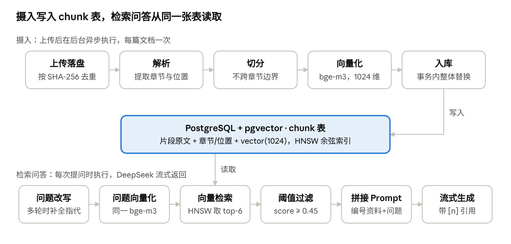

# 超级知识库：文档摄入与检索问答实现说明

2026-10-29 · [在线版](https://claude.ai/code/artifact/65ce178b-e780-41b2-9bfe-34d933a50508)

## 概述

系统有两条核心链路：**摄入**把上传的 Word / Excel / PPT / PDF 变成带出处信息的向量片段和关键词索引，存进 PostgreSQL；**检索问答**用向量和关键词两路在同一个库里召回片段，经交叉编码器精排、过滤掉不相关的片段后，拼成带编号的参考资料交给 DeepSeek 流式回答，并要求标注 `[n]` 引用。

两条链路共用同一个 embedding 模型（Ollama 本地 bge-m3，1024 维）和同一张 `chunk` 表：摄入写、检索读。向量和业务数据都在 PostgreSQL（pgvector 扩展）里，没有独立的向量数据库。



上排每篇文档执行一次，下排每次提问执行一次；两条链路通过 `chunk` 表和同一个 bge-m3 模型衔接。

| 环节 | 代码位置 | 外部依赖 |
| --- | --- | --- |
| 上传、去重、文件存储 | `document/DocumentController`、`DocumentService`、`FileStorage` | 本地磁盘 `./data/files` |
| 异步调度、向量化、入库 | `ingestion/IngestionService`、`ChunkRepository` | Ollama bge-m3、PostgreSQL |
| 解析 | `ingestion/DocumentParser`、`TikaBlockHandler` | Apache Tika 3 |
| 切分 | `ingestion/Chunker` | 无 |
| 问题改写、拼接 Prompt、流式生成 | `chat/ChatController`、`ChatService` | DeepSeek API |
| 混合检索与召回过滤 | `retrieval/Retriever`、`KeywordAnalyzer` | Ollama bge-m3、PostgreSQL |
| 精排 | `retrieval/RerankClient`、`scripts/rerank_server.py` | 本地 Rerank 服务（bge-reranker-v2-m3） |

技术栈：Spring Boot 4 + Spring AI 2、Apache Tika 3、PostgreSQL 17 + pgvector；持久层用 `JdbcClient` 手写 SQL，表结构由 Flyway 管理。下文代码均摘自仓库当前版本，略去了与主流程无关的部分。

## 摄入一：上传、去重与异步调度

上传接口只负责「落盘 + 登记」，立即返回；解析、切分、向量化都在后台线程池里异步完成，前端通过轮询文档状态看进度。

**入口**：`POST /api/knowledge-bases/{kbId}/documents`，multipart 字段名 `files`，可一次传多个文件。单文件上限 200MB、单次请求 1GB（`spring.servlet.multipart`）。每个文件单独返回结果：`ACCEPTED` / `DUPLICATE` / `REJECTED`，一个文件失败不影响同批其他文件。

`DocumentService.uploadOne` 的处理顺序：

1. **校验类型**：`DocType.fromFilename` 按扩展名判断，支持 doc/docx、xls/xlsx、ppt/pptx、pdf、txt/md；其他类型和空文件直接 `REJECTED`。
2. **边写边算哈希**：`FileStorage.store` 把上传流写进 `tmp/` 下的临时文件，同时用 `DigestOutputStream` 算 SHA-256，文件只读一遍。
3. **按哈希命名落盘**：移动到 `{storageDir}/{kbId}/{sha256}.{扩展名}`。用内容哈希命名，相同内容只存一份，也避开了文件名里的特殊字符；原始文件名只记在数据库里。
4. **去重**：同一知识库内已有相同 `sha256` 的文档就返回 `DUPLICATE`。表上还有 `UNIQUE (kb_id, sha256)` 约束兜底，并发上传同一文件时由 `DuplicateKeyException` 捕获。
5. **登记并投递任务**：在 `document` 表插入一行，状态 `PENDING`，然后调用 `IngestionService.submit(id)`。

```java
// FileStorage.store：一遍读流同时得到文件和哈希
try (InputStream in = file.getInputStream();
     OutputStream out = new DigestOutputStream(Files.newOutputStream(temp), digest)) {
    in.transferTo(out);
}
String sha = HexFormat.of().formatHex(digest.digest());
String relative = kbId + "/" + sha + "." + DocType.extension(file.getOriginalFilename());
Files.move(temp, resolve(relative), StandardCopyOption.REPLACE_EXISTING);
```

**异步调度**（`IngestionService`）：

- 线程池是固定大小的虚拟线程池，大小取 `skb.ingestion.concurrency`（默认 2）。限制并发是为了不压垮本地 Ollama：批量上传几十个文件时，其余的在队列里等。
- `inFlight` 集合记录正在处理的文档 ID，同一篇文档不会被重复提交；处理中点「重新处理」会得到 409。
- 状态依次变为 `PENDING → PARSING → EMBEDDING → READY`，任一步抛异常则为 `FAILED`，错误信息截取前 500 字存进 `error_msg`，前端直接展示。
- **断点恢复**：应用启动完成时（`ApplicationReadyEvent`），把状态仍是 `PENDING` / `PARSING` / `EMBEDDING` 的文档重新提交。服务中途重启不会留下「永远在处理中」的文档。
- **重新处理**：`POST /api/documents/{id}/reindex` 把状态置回 `PENDING` 再提交，原始文件从磁盘重新读取。调整切分参数或换解析逻辑后用它刷新。

```java
// IngestionService.process：一篇文档的完整摄入过程
documents.updateStatus(documentId, DocumentStatus.PARSING, null);
List<TextUnit> units = parser.parse(fileStorage.resolve(doc.filePath()), doc.filename());
List<ChunkDraft> drafts = chunker.chunk(units, DocType.fromFilename(doc.filename()));
if (drafts.isEmpty()) {
    throw new IllegalStateException("未从文件中提取到文字内容（扫描件或纯图片需要 OCR，当前版本暂不支持）");
}
documents.updateStatus(documentId, DocumentStatus.EMBEDDING, null);
List<float[]> embeddings = embed(doc.filename(), drafts);
transactionTemplate.executeWithoutResult(status -> {
    chunks.deleteByDocument(documentId);
    chunks.insertAll(documentId, doc.kbId(), drafts, embeddings);
    documents.markReady(documentId, drafts.size());
});
```

## 摄入二：解析

解析的产出不是一整段纯文本，而是一串 `TextUnit`：每个单元是一个段落或一行表格，带着它所属的**章节路径**和**物理位置**。这两样信息后面会决定切分边界、参与向量化，并最终显示在引用出处里。

```java
// TextUnit：解析与切分之间的接口
record TextUnit(String text,        // 段落或一行表格
                String headingPath, // 如 "第二章 考勤与假期 > 2.2 年假"
                int unit,           // PDF 页 / 幻灯片 / 工作表序号，从 1 开始；无则为 0
                String location)    // 如 "第3页"、"第2张幻灯片"、"工作表：价格"
```

解析分两层：

1. **Tika 转成统一的块**：`AutoDetectParser` 把任意格式输出成 XHTML 事件流，`TikaBlockHandler`（SAX 处理器）把它整理成三类 `Block`：标题（`h1`–`h6`）、段落、表格（二维单元格）。处理器同时做三件事：
    - 遇到 `div.page` / `div.sheet` / `div.slide-content` 时把物理单元计数加一，记到之后每个块上；
    - 跳过页眉、页脚、嵌入对象和 `script` / `style`；
    - 清理空白：PDF 是按行输出的，中文句子中间的换行会被直接删掉而不是变成空格。
2. **按格式整理成 `TextUnit`**（`DocumentParser`），规则见下表。

| 格式 | 章节路径怎么来 | 位置信息 | 特殊处理 |
| --- | --- | --- | --- |
| Word / txt / md | 优先用标题样式；整篇没有标题样式时用编号规则推断 | 无 | Markdown `#` 标题按 `#` 的个数定级 |
| PDF | 同上（PDF 通常没有样式，靠编号规则） | `第N页` | 按内容流顺序抽取；去页眉页脚和目录、接回被换行截断的句子（见下文）；不做 OCR，不抽取图片 |
| PPT | 每张幻灯片的第一段文字当作标题 | `第N张幻灯片` | 幻灯片之外的内容记为「演讲备注」 |
| Excel | 无 | `工作表：{名称}` | 每行转成「列名: 值」 |

**PDF 文本整理**（`PdfTextCleaner`）。PDFBox 通常一行输出一个段落，直接切块会把版面噪声带进片段，所以 PDF 的块在推断标题前先做三步整理：

1. **去页眉页脚**：不超过 40 字、把数字替换掉后在超过一半页面（且至少 3 页）上重复出现的行，视为页眉页脚删除，如「彩讯科技股份有限公司员工手册」「内部资料，严禁对外传阅和翻印 12」。
2. **去目录行**：以连续点号加页码结尾的行，如「第二章 职业礼仪 ........ 6」。
3. **接回换行截断的句子**：上一行排满版面（长度达到全文 80 分位行长的 70%）且不以句末标点或冒号结尾，下一行也不是编号、项目符号或标题开头，就把两行接成一段。只在同一页内合并。

抽取时没有开启 Tika 的 `sortByPosition`。按坐标排序会把双栏排版中同一高度的左右两栏拼成一行，例如员工手册考勤页会变成「1、迟到　年度考核为"S"的员工……」；保持内容流顺序时，常见排版工具生成的双栏 PDF 会先输出左栏再输出右栏。

**编号规则推断标题**（`guessHeadingLevel`）。很多制度文件用手打的编号代替标题样式，所以按下面的顺序匹配，超过 40 字或以句末标点结尾的段落一律不当标题：

| 形式 | 示例 | 层级 |
| --- | --- | --- |
| 第X编、单独一行的「附则」 | 第二编 物 权 | 1 |
| 第X分编 | 第一分编 通 则 | 2 |
| 第X章 / 篇 / 部分 | 第三章 请假制度 | 3 |
| 第X节、中文数字加顿号 | 第二节 / 一、总则 | 4 |
| 括号中文数字 | （一）适用范围 | 5 |
| 小数编号（首段最多两位数，排除年份、金额） | 2.1 年假 → 5；2.1.3 → 6 | 段数 + 3，最多 8 |

「编」「分编」是法律的结构，在「章」之上，民法典的章节路径因此是「第二编 物 权 > 第一分编 通 则 > 第一章 一般规定」。层级只用来决定谁覆盖谁，数字本身没有含义，没有「编」的文档里路径不受影响。

章节路径用一个按层级索引的数组维护：遇到 N 级标题就写入第 N 格并清空更深的层级，每个段落取当前数组里的非空项，用 ` > ` 连起来。

**样式标题去掉自动编号**（`stripHeadingNumber`）。Word 多级列表的编号由 Tika 计算，经常算错，需求文档里出现过「1.4.1.4.1.1.1. 查看活动」这样的标题。错误的编号进入章节路径后，会跟着进入向量文本和精排输入，所以样式标题开头的小数编号一律去掉，只保留标题文字。「第二章」这类中文编号不受影响。

**丢弃噪声行**。单独成行的页码（「－1－」「- 2 -」）和「目录」标题没有检索价值，解析时直接丢弃。

**表格转成「列名: 值」**（`tableLines`）。表格如果按行直接拼成文本，切分后中间几行会丢掉表头，变成无法理解的数字串。现在每行都自带表头语义：

```
输入：  | 岗位 | 城市 | 住宿标准 |
        | 经理 | 北京 | 600   |
输出：  岗位: 经理；城市: 北京；住宿标准: 600
```

表格开头只有一个非空单元格的行（合并单元格写的表名）单独保留为一行；不足两行或不足两列的表格退化为用 ` | ` 连接单元格。

解析失败（文件损坏、加密等）会抛出 `IOException("文件解析失败：...")`；解析成功但提不出任何文字（扫描版 PDF、纯图片）会在切分后被拦下，两种情况文档都会变为 `FAILED`。

## 摄入三：切分

`Chunker` 把 `TextUnit` 合并成片段（`ChunkDraft`），原则是**先尊重结构边界，再控制长度**：一个片段只属于一个章节，字数尽量接近 600、不超过 1000。这样召回的片段主题单一，引用出处也能精确到章节。

```java
record ChunkDraft(String content, String headingPath, String location) {}
```

**第一步：把不可分的段落归成组**（`groups`）。按段落直接合并时，切点可能落在「有下列情形之一的：」和「（一）（二）（三）」之间，列举项和题干被分到两个片段。以前劳动合同法第十四条就是这样：精排只看到片段里的三个列举项，看不到「应当订立无固定期限劳动合同」，LLM 拿到的资料也不完整。所以切分前先把下面这些情况归成一组，后面只在组与组之间切：

| 后一段落 | 归入上一段落所在的组，条件是 |
| --- | --- |
| 以「第X条」开头 | 从不归入，总是开始新组 |
| 法律文本中的其他段落 | 总是归入，它是上一条的款或项。至少 3 个段落以「第X条」开头时才认定为法律文本 |
| 列举项：（一）、1、、1.、a)、一、、项目符号 | 总是归入 |
| 其他段落 | 上一段落以冒号结尾（引导句）时归入 |

组不跨章节；PPT、Excel 不分组，每行、每段各自成组。

**第二步：拆超长单元**（`split`）。单个段落超过 `max-chars`（1000）时，按句子拆成不超过 `target-chars`（600）的小单元，拆出来的小单元仍属于原来的组。句子边界是 `。！？!?；;` 和换行；没有任何标点的超长句只能每 600 字硬切。

**第三步：按组合并**（`chunk`）。依次把组放进当前片段，放入前先判断是否要先把当前片段结束掉：

| 触发条件 | 类型 | 新片段怎么开头 |
| --- | --- | --- |
| 章节路径变了 | 结构边界（所有格式） | 从空白开始 |
| 幻灯片 / 工作表变了 | 结构边界（仅 PPT、Excel） | 从空白开始 |
| 当前已达 600 字，或放入整组后会超 1000 字 | 长度已满 | 从空白开始 |

```java
// Chunker.chunk 主循环
boolean boundary = !Objects.equals(last.headingPath(), first.headingPath())
        || (breakOnUnit && last.unit() != first.unit());   // breakOnUnit = PPT || EXCEL
boolean full = currentLength >= targetChars || currentLength + groupLength > maxChars;
if (boundary || full) {
    chunks.add(toDraft(current, type));
    current = new ArrayList<>();
}
```

组与组之间切分时不重叠，因为组边界本身就是语义边界。以前按长度切分时会带上前一块末尾的句子，法律片段因此常以上一条的半截内容开头。

**超长的组只能在组内切**（`splitGroup`）。一组超过 1000 字时（典型是列举很多项的条文），按单元拆成多个片段，后续片段的开头二选一：

- 组内出现过不超过 300 字的引导句（以冒号结尾）时，重复最近的那一句，让列举项不脱离题干。例如「第十条 有下列情形之一的，不得解除合同：」后面的（四）（五）项，所在片段也以这句开头；
- 否则带上一块最后一个单元末尾不超过 100 字的完整句子（`overlapTail`），避免跨块的一句话上下文断开。重叠以整句为单位；上一个单元本身不到 100 字时（典型是一行表格）不重复它。

组内的最后一段留在当前片段里，可以和后面的短组继续合并。

**按组切分的效果**（六份题集，改动前后各跑一次）：检索评测 laws 的 Hit@1 从 93.8% 升到 100%，laws_hard 从 55.0% 升到 70.0%，其余题集持平；答案级评测答对从 104/109 升到 106/109，「劳动合同法第十四条」从部分答对变为答对。也验证过「缩短片段能否提高精排分数」：把「10岁的孩子自己买游戏装备算数吗」对应的 671 字片段缩到只剩第十九条，精排分数仍是 0.0025，这道题差在口语化问法与法条术语对不上，不在片段长度，所以没有调小 `target-chars`。

**位置合并**（`toDraft`）。片段内的单元用换行拼接，章节路径和位置取第一个单元的。PDF 允许跨页合并，因为一个章节常常跨页，按页切会拆断正文；这时位置记为页码范围，如 `第3-4页`。前端点击引用打开 PDF 时，用范围的起始页拼成 `#page=3` 跳转。

切分参数都在 `skb.chunk.*`，单元测试 `ChunkerTests` 覆盖了章节切分、PDF 跨页 vs PPT 不跨页、超长段落按句拆分并重叠、列举项不脱离引导句、法律条文不被切开、超长列举重复引导句等场景。

## 摄入四：向量化与存储

每个片段用 Ollama 的 bge-m3 转成 1024 维向量，和原文、出处一起写进 PostgreSQL 的 `chunk` 表。有两个设计要点：向量化的文本和入库的原文不同；旧片段的删除和新片段的写入在同一个事务里。

**向量文本 = 出处信息 + 原文**（`IngestionService.embeddingText`）。片段本身往往不包含文件名和章节名，比如「员工手册」里的「年假」一节正文可能只写「入职满一年享有 5 天……」。把出处拼在前面再向量化，「员工手册里的年假规定」这类问题更容易命中。数据库里只存原文，展示和拼 Prompt 时不会重复这些头部。

```java
static String embeddingText(String filename, ChunkDraft draft) {
    StringJoiner header = new StringJoiner("\n");
    header.add("文件：" + filename);
    if (draft.headingPath() != null) header.add("章节：" + draft.headingPath());
    if (draft.location() != null)    header.add("位置：" + draft.location());
    return header + "\n\n" + draft.content();
}
```

**分批调用 embedding**：每批 `skb.ingestion.embedding-batch-size`（16）个片段调用一次 `EmbeddingModel.embed(List<String>)`。批量调用比逐条调用少很多 HTTP 往返；批次不过大，可以控制单次请求对 Ollama 的内存压力。`EmbeddingModel` 由 Spring AI 自动装配，`spring.ai.model.embedding: ollama` 决定用哪个实现。

**批量入库**（`ChunkRepository.insertAll`）：用 `JdbcTemplate.batchUpdate` 一次写入整篇文档的片段。向量由 `PgVectors.toLiteral` 转成 `[0.1,0.2,...]` 文本，在 SQL 里用 `?::vector` 转换，不需要 pgvector 的 Java 驱动。

```java
jdbcTemplate.batchUpdate("""
        INSERT INTO chunk (document_id, kb_id, chunk_index, content, heading_path, location, embedding)
        VALUES (?, ?, ?, ?, ?, ?, ?::vector)
        """, args);
```

**事务内原子替换**：「删除该文档旧片段 → 插入新片段 → 标记 `READY` 并写入片段数」包在一个 `TransactionTemplate` 里。重新处理一篇文档时，检索要么看到完整的旧片段、要么看到完整的新片段，不会出现半新半旧。耗时的解析和向量化都在事务外完成，事务只包含几条 SQL，不会长时间占用连接。

**表结构**（`V1__init.sql`）：

```sql
CREATE TABLE chunk (
    id           BIGSERIAL PRIMARY KEY,
    document_id  BIGINT  NOT NULL REFERENCES document (id) ON DELETE CASCADE,
    kb_id        BIGINT  NOT NULL,      -- 冗余，检索时按知识库过滤不用关联 document
    chunk_index  INT     NOT NULL,
    content      TEXT    NOT NULL,      -- 片段原文（不含向量化时拼的头部）
    heading_path TEXT,
    location     VARCHAR(200),
    embedding    vector(1024) NOT NULL  -- bge-m3 的维度
);
CREATE INDEX idx_chunk_kb ON chunk (kb_id);
CREATE INDEX idx_chunk_embedding ON chunk USING hnsw (embedding vector_cosine_ops);
```

- 向量索引是 HNSW，距离类型是余弦（`vector_cosine_ops`），参数用 pgvector 默认值（`m = 16`、`ef_construction = 64`）。新片段插入时自动加进索引，不需要重建。
- 删除文档时，片段由外键 `ON DELETE CASCADE` 自动删除，原始文件由 `DocumentService.delete` 从磁盘删除。
- `knowledge_base.embedding_model` 记录建库时用的 embedding 模型。向量维度写死在表结构里，更换模型需要新增迁移并重新处理全部文档。

## 检索问答一：问题改写与问题向量化

多轮对话时，先用 DeepSeek 把最新问题改写成不依赖上下文的完整问题，再拿它去向量化和检索。第一轮问题不改写，直接用原文。

**入口**：`POST /api/conversations/{id}/chat`，请求体 `{"question": "..."}`，响应是 SSE 流。`ChatService.chat` 先做两项前置检查：问题不能为空；DeepSeek Key 已配置。不满足时直接返回一个 `error` 事件，不走后面的流程。

通过后进入 `prepare`，它在 `boundedElastic` 线程上运行，因为这一步全是阻塞调用（查库、改写、向量化）：

1. **取历史**：读取该会话最近 `skb.chat.history-messages`（6）条消息，即最近 3 轮问答。
2. **保存问题**：把本次问题写入 `message` 表。如果是会话的第一个问题，用它的前 30 个字当会话标题。
3. **改写问题**：有历史时调用 `rewriteQuery`，没有历史就用原问题。
4. **检索**：用改写后的问题调用 `Retriever.retrieve`，见下一节。

**为什么要改写**：追问通常是不完整的。上一轮问「年假有几天」，这一轮问「那病假呢？」。直接对「那病假呢？」做向量检索，语义太少召回不准；改写成「病假有几天？」后才能命中病假章节。

```java
private static final String REWRITE_SYSTEM_PROMPT = """
        你是检索查询改写助手。根据对话历史，把用户的最新问题改写成一个语义完整、可以独立用于知识库检索的问题：
        补全代词和省略的主语，保留专有名词、编号和数字。只输出改写后的问题，不要任何解释。
        如果最新问题本身已经完整，原样输出。
        """;
```

- 历史以「用户：… / 助手：…」的纯文本传给模型，每条只取前 300 字。助手的长回答对补全指代帮助不大，截断可以省 token、加快改写。
- 改写用的是同步调用（`.call().content()`），因为后续检索要等它的结果。
- **降级**：改写调用抛异常或返回空内容时，退回用原问题检索，只记一条 warn 日志，不影响后续回答。
- 改写后的问题会作为 `searchQuery` 存进答案消息的 `retrieval_trace`，排查「为什么没检索到」时可以直接看到实际用于检索的是什么。

**问题向量化**在 `Retriever.fuse` 里完成：`embeddingModel.embed(query)` 用和摄入时同一个 bge-m3 模型，把问题转成 1024 维向量。问题和片段必须用同一个模型，否则两边的向量不在同一个空间里，距离没有意义。问题不加任何前缀；片段向量化时加的「文件 / 章节 / 位置」头部，是为了让问题里提到的文件名、章节名也能匹配上。

## 检索问答二：混合检索、精排与召回过滤

检索分两路召回、融合后再精排，入口是 `Retriever.rank`：

1. **向量召回**：HNSW 余弦检索，取最相近的 `candidates`（30）个，擅长换了说法的问题；
2. **关键词召回**：BM25，同样取 30 个，擅长条款号、编号、型号这类向量不敏感的字面信息；
3. **融合排序**：精确命中问题中编号的片段排最前，其余按加权 RRF 排序；
4. **精排**：RRF 前 `rerank.candidates`（20）个片段交给交叉编码器逐对打分，按精排分数重排，精确命中仍排最前；
5. **召回过滤**（仅问答）：只保留精排分数 ≥ `rerank.min-score`（0.01）或精确命中的片段，取前 `top-k`（6）个。精排服务不可用时退回 RRF 顺序，改用余弦相似度 ≥ `retrieval.min-score`（0.5）过滤。

为什么要加关键词一路：只有向量召回时，「劳动合同法第三十九条」「民法典第1079条」这类按条款号提问的题，14 道里只有 1 道排第一（`scripts/eval/laws_article.csv`）。bge-m3 把「第三十九条」和「第二十九条」看成几乎一样的东西，而且错误结果的相似度都在 0.5 以上，阈值也拦不住。

**调用链**（`retrieval/Retriever`，下面各小节按这个顺序展开）：

```text
retrieve(kbId, query)                          问答入口；调试接口走 search()，不做过滤
├─ rank()
│  ├─ fuse()
│  │  ├─ embeddingModel.embed(query)           问题向量，事务外先算好
│  │  ├─ KeywordAnalyzer.queryTerms(query)     查询词项
│  │  └─ 只读事务 ─────────────────────────────────────────────
│  │     ├─ vectorSearch()                     → 30 个 (chunkId, 余弦相似度)
│  │     ├─ keywordSearch()                    → 30 个 (chunkId, BM25 分数)
│  │     ├─ 加权 RRF 合并两路排名
│  │     └─ loadChunks()                       → 片段详情、补算余弦、判断精确命中
│  └─ rerank()                                 事务外
│     └─ RerankClient.score() ──HTTP──▶ scripts/rerank_server.py（前 20 个）
└─ filter(relevant).limit(6)
```

### 向量召回

```java
// Retriever.vectorSearch（略去参数绑定）
// 带 kb_id 过滤时让 HNSW 继续扫描，避免存在多个知识库时召回数量不足
jdbc.sql("SET LOCAL hnsw.iterative_scan = relaxed_order").update();
List<Hit> hits = jdbc.sql("""
        SELECT c.id AS chunk_id, 1 - (c.embedding <=> CAST(:vector AS vector)) AS score
        FROM chunk c
        WHERE c.kb_id = :kbId
        ORDER BY c.embedding <=> CAST(:vector AS vector)
        LIMIT :limit
        """)...;
// relaxed_order 下结果可能略微乱序
return hits.stream().sorted(Comparator.comparingDouble(Hit::score).reversed()).toList();
```

逐项说明：

- **`<=>` 与 score**：`<=>` 是 pgvector 的余弦距离运算符，取值 0～2，越小越相似。`1 - 距离` 就是余弦相似度，作为 `score` 返回，越大越相关。
- **走索引**：`ORDER BY 距离 LIMIT k` 正好是 HNSW 索引能加速的查询形式，不会对全表做距离计算。
- **按知识库过滤**：`chunk.kb_id` 是冗余列，过滤时不用先关联 `document`。
- **`iterative_scan`**：HNSW 先在所有知识库的向量里取出一批候选（默认 `ef_search = 40` 个），再按 `kb_id` 过滤。如果候选大多属于别的知识库，过滤后可能凑不够数。pgvector 0.8 的 `iterative_scan` 在数量不够时会继续沿图向外搜。`relaxed_order` 模式为了速度允许结果顺序有轻微偏差，所以代码最后在 Java 里按 score 重新排序。
- **只读事务**：`SET LOCAL` 只在当前事务内有效，必须和查询在同一个事务里，所以两路召回和取详情都放在一个只读的 `TransactionTemplate` 里。设置不会泄漏到连接池里的其他请求。

### 关键词召回（BM25）

PostgreSQL 自带的全文检索不会切中文，装 zhparser / pg_jieba 又要自己构建数据库镜像。所以分词在 Java 里完成（`KeywordAnalyzer`），切好的词项直接写成 `tsvector` 存进 `chunk.keyword_tsv`，PG 只负责 GIN 索引和打分，不再分词。建索引和查询用同一套规则：

| 规则 | 示例 |
| --- | --- |
| 中文按二字组切分，单字连续段保留单字 | 年假天数 → 年假 / 假天 / 天数 |
| 英文、数字按整词保留并转小写；带下划线的再拆出各段 | Q5 → q5；RW_202607050001 → rw_202607050001 / rw / 202607050001 |
| 条款编号统一成阿拉伯数字，编号本身不再切二字组 | 第一千零七十九条、第1079条、1079条 → 第1079条 |
| 全角字符先转半角（NFKC） | 第８２条 → 第82条 |
| 仅查询：先去掉疑问词 | 「是什么」「怎么」「哪些」「多少」「吗」等 |

条款号不切二字组，是因为「三十」「九条」会命中所有「第三十X条」，反而把要找的那条挤下去。疑问词要去掉，是因为它们在制度、法规正文里很少出现，IDF 反而很高。

**分词**（`KeywordAnalyzer.analyze`，略去英文数字部分）：先抽出条款编号，再对剩下的连续汉字切二字组。

```java
String normalized = Normalizer.normalize(text, Normalizer.Form.NFKC).toLowerCase(Locale.ROOT);

// ① 条款编号整体抽出，统一成"第N条"，并从原文中挖掉，后面不再对它切二字组
Matcher article = ARTICLE.matcher(normalized);
StringBuilder rest = new StringBuilder();
while (article.find()) {
    String number = article.group(1) != null ? article.group(1) : article.group(2);
    long value = Character.isDigit(number.charAt(0)) ? parseArabic(number) : parseChinese(number);
    if (value > 0) {
        terms.add("第" + value + article.group(3));
        article.appendReplacement(rest, " ");
    }
}
article.appendTail(rest);
String remaining = rest.toString();

// ② 连续汉字按二字组滑动切分，只有一个字的单独保留
Matcher han = HAN_RUN.matcher(remaining);
while (han.find()) {
    String run = han.group();
    if (run.length() == 1) terms.add(run);
    for (int i = 0; i + 2 <= run.length(); i++) terms.add(run.substring(i, i + 2));
}

// ③ 英文、数字按 [a-z0-9_]+ 整词保留，带下划线的再拆段，长度不足 2 的丢弃
```

查询时先去掉疑问词，再用同一个 `analyze` 切分，并对结果去重：

```java
public static List<String> queryTerms(String query) {
    String stripped = query == null ? null : QUESTION_WORDS.matcher(query).replaceAll(" ");
    return List.copyOf(new LinkedHashSet<>(analyze(stripped)));
}
```

**索引**：V4 迁移给 `chunk` 加了 `keyword_tsv`（GIN 索引）和 `keyword_token_count`（词项总数，即 BM25 的文档长度）两列。词项来自「章节路径 + 正文」，章节名里的「证件办理」「车辆管理」往往就是用户的检索词。新片段在 `ChunkRepository.insertAll` 写入时生成；V4 之前入库的片段由 `KeywordIndexBackfill` 在应用启动后于后台补齐，只需分词，不用重新向量化。

```java
// ChunkRepository.insertAll（略去其他列）
List<String> terms = KeywordAnalyzer.analyze(headingPath == null ? content : headingPath + "\n" + content);
args.add(new Object[]{..., KeywordAnalyzer.toTsvector(terms), terms.size()});
jdbcTemplate.batchUpdate("""
        INSERT INTO chunk (..., keyword_tsv, keyword_token_count)
        VALUES (..., ?::tsvector, ?)
        """, args);
```

`toTsvector` 把词项拼成 tsvector 字面量，比如 `'q5':1 '年假':2,7`，冒号后面是该词项出现的位置，位置个数就是 BM25 里的词频 tf。这里直接把字面量转换成 `tsvector`，而不是调用 `to_tsvector()`：后者会用 PG 自己的解析器重新分词，而它不认识中文。

**打分**：标准 BM25，`k1 = 1.2`、`b = 0.75`。文档数 N、每个词的文档频率 df、平均文档长度都按当前知识库实时统计；词频 tf 取 `tsvector` 中该词项的位置个数：

```text
idf(t)  = ln(1 + (N - df + 0.5) / (df + 0.5))
score   = Σ idf(t) · tf · (k1 + 1) / (tf + k1 · (1 - b + b · 文档长度 / 平均文档长度))
```

```java
// Retriever.keywordSearch：:terms 是空格连接的查询词项，:tsquery 是 'q5' | '系统' | ...
jdbc.sql("""
        WITH stats AS (                                    -- 当前知识库的片段数 N、平均文档长度
            SELECT count(*) AS n, greatest(avg(keyword_token_count), 1) AS avgdl
            FROM chunk WHERE kb_id = :kbId
        ), idf AS (                                        -- 每个查询词项的 df 和 idf，库里没有的词项直接丢掉
            SELECT q.term, ln(1 + (s.n - d.df + 0.5) / (d.df + 0.5)) AS idf
            FROM unnest(string_to_array(:terms, ' ')) AS q(term)
            CROSS JOIN stats s
            CROSS JOIN LATERAL (
                SELECT count(*) AS df FROM chunk c
                WHERE c.kb_id = :kbId AND c.keyword_tsv @@ CAST(quote_literal(q.term) AS tsquery)
            ) d
            WHERE d.df > 0
        ), tf AS (                                         -- 候选片段中每个命中词项的 tf
            SELECT c.id, c.keyword_token_count AS dl, u.lexeme, coalesce(cardinality(u.positions), 1) AS tf
            FROM chunk c CROSS JOIN LATERAL unnest(c.keyword_tsv) AS u
            WHERE c.kb_id = :kbId AND c.keyword_tsv @@ CAST(:tsquery AS tsquery)
              AND u.lexeme = ANY (string_to_array(:terms, ' '))
        )
        SELECT tf.id AS chunk_id,
               sum(i.idf * tf.tf * (:k1 + 1) / (tf.tf + :k1 * (1 - :b + :b * tf.dl / s.avgdl))) AS score
        FROM tf JOIN idf i ON i.term = tf.lexeme CROSS JOIN stats s
        GROUP BY tf.id
        ORDER BY score DESC
        LIMIT :limit
        """)...;
```

- **stats**：N 和平均长度都按 `kb_id` 实时统计，不同知识库的 idf 互不影响，新增文档后也不需要重建统计。
- **idf**：每个词项单独查一次 df（`@@` 单个词项，走 GIN 索引）。df = 0 的词项在库里不存在，不参与打分。
- **tf**：`unnest(tsvector)` 把片段的 tsvector 展开成 `(lexeme, positions)` 行，只保留查询中出现的词项，`positions` 的个数就是 tf。
- **最终得分**：按片段把各词项的 BM25 贡献相加。只返回 `chunk_id` 和分数，片段详情在融合后由 `loadChunks` 统一查询。

SQL 先用 `keyword_tsv @@ 'q5' | '系统' | ...`（任一词项命中，走 GIN 索引）筛出候选，再 `unnest(keyword_tsv)` 取出命中词项的 tf 求和。在当前几百个片段的库上单次查询 15～100 ms。它要对每个候选展开全部词项，片段数到几万时需要关注耗时。

### 融合排序

```java
private List<RetrievedChunk> fuse(long kbId, String query, Mode mode, int poolSize) {
    String vector = PgVectors.toLiteral(embeddingModel.embed(query));
    List<String> terms = KeywordAnalyzer.queryTerms(query);
    return readOnlyTx.execute(status -> {
        List<Hit> vectorHits = mode == Mode.KEYWORD ? List.of() : vectorSearch(kbId, vector, poolSize);
        List<Hit> keywordHits = mode == Mode.VECTOR || terms.isEmpty() ? List.of() : keywordSearch(kbId, terms, poolSize);

        // 两路结果只取排名（从 1 开始），按加权 RRF 累加
        Map<Long, Integer> vectorRanks = ranks(vectorHits);
        Map<Long, Integer> keywordRanks = ranks(keywordHits);
        Map<Long, Double> fused = new HashMap<>();
        vectorRanks.forEach((id, rank) -> fused.merge(id, 1.0 / (rrfK + rank), Double::sum));
        keywordRanks.forEach((id, rank) -> fused.merge(id, keywordWeight / (rrfK + rank), Double::sum));
        if (fused.isEmpty()) {
            return List.of();
        }

        Set<String> exactTerms = mode == Mode.VECTOR ? Set.of() : KeywordAnalyzer.exactTerms(terms);
        Map<Long, ChunkRow> rows = loadChunks(fused.keySet(), vector, exactTerms);
        // 问题里写明了"第39条""Q5"这类编号时，包含它的片段几乎一定是用户要找的，直接排到最前
        return rows.values().stream()
                .sorted(Comparator.comparing(ChunkRow::exactMatch).reversed()
                        .thenComparing(Comparator.comparingDouble((ChunkRow r) -> fused.get(r.chunkId())).reversed())
                        .thenComparing(Comparator.comparingDouble(ChunkRow::score).reversed()))
                .map(r -> new RetrievedChunk(..., null /* rerankScore */, r.exactMatch(),
                        r.score() >= minScore || r.exactMatch()))   // 未精排时的 relevant
                .toList();
    });
}
```

`loadChunks` 用一条 SQL 取出所有候选的详情，同时补算余弦相似度，并用 tsquery 判断是否包含问题中的精确词项：

```sql
SELECT c.id AS chunk_id, c.document_id, d.filename, c.heading_path, c.location, c.content,
       1 - (c.embedding <=> CAST(:vector AS vector)) AS score,
       coalesce(c.keyword_tsv @@ CAST(:exact AS tsquery), false) AS exact_match   -- 问题中没有精确词项时为 false
FROM chunk c JOIN document d ON d.id = c.document_id
WHERE c.id IN (:ids)
```

- **精确命中优先**：问题中的「精确词项」指条款编号、字母数字混合的编号（q5、rw_202607050001）和 5 位以上的数字（商品编码等）。片段包含其中任意一个时 `exactMatch = true`，排在所有片段前面。
- **加权 RRF**：其余片段的得分为 `1 / (rrf-k + 向量排名) + keyword-weight / (rrf-k + 关键词排名)`，只出现在一路时只算该路。RRF 只看排名、不看分数，余弦相似度和 BM25 分数的量纲不同也能直接融合。
- **参数**：`rrf-k = 10`、`keyword-weight = 0.25`，是在四份题集上网格搜索得到的。常见的 `k = 60` 等权融合会让 laws 题集的 Hit@1 从 100% 掉到 56%。k 越大，各名次之间的分差越小：k = 60 时向量第 1 名和第 9 名只差 0.002，关键词这一路随便贡献一点就能把顺序翻过来。而二字组 BM25 对改写、口语化的问题噪声很大，例如「租房合同最长能签多少年」会命中一堆含「合同」的劳动合同法条文。
- **结果中的分数**：`score` 始终是与问题的余弦相似度，只从关键词召回的片段也会补算。另有 `keywordScore`（BM25）、`vectorRank`、`keywordRank`、`rerankScore`（精排分数，未精排时为 null）、`exactMatch` 字段用于排查，`relevant` 表示是否通过召回过滤。

不同方式在四份题集上的 Hit@1 / 问答可用率（`python3 scripts/eval_retrieval.py --mode vector|hybrid ...`）：

| 题集 | 内容 | 纯向量 | 混合检索 |
| --- | --- | --- | --- |
| `laws.csv` | 法律法规，改写 / 口语化问法 | 100% / 100% | 100% / 100% |
| `laws_article.csv` | 按条款号提问 | 7.1% / 35.7% | 92.9% / 100% |
| `handbook.csv` | 员工手册（双栏 PDF） | 78.9% / 94.7% | 89.5% / 100% |
| `requirements.csv` | 需求文档中的编码、ID、字段规则 | 80.0% / 85.0% | 95.0% / 100% |

无答案题的拒答率不变（laws 100%，handbook 0%，requirements 33.3%）。混合检索解决的是「找得到、排得准」，判断「库里到底有没有答案」交给下面的精排。

### 精排（Rerank）

**为什么要精排**。向量检索是双编码器：问题和片段各自压缩成一个向量再比较余弦，只能反映「话题像不像」。「迟到一次扣多少钱」会以 0.66 的高分命中「考勤处罚」章节，但那一节只写了「依据《员工考勤管理规定》执行」，并没有金额；「转正后辞职要提前多久」和试用期「提前三日」的片段在向量上也几乎分不开。新增的难题集（`handbook_hard.csv`、`laws_hard.csv`）上，正确片段的余弦最低 0.53，无答案题的最高分却有 0.66，阈值怎么调都分不开。

交叉编码器（bge-reranker-v2-m3）把「问题 + 片段」拼成一条输入，让模型逐字对照后直接输出相关性。它比双编码器准得多，但每对都要实时推理，没法对全库做，所以只对 RRF 的前 20 个片段精排：两路召回负责「别漏掉」，精排负责「排准、判断有没有答案」。

**服务**。`scripts/rerank_server.py` 用 sentence-transformers 加载模型，在 Apple Silicon 上走 MPS、fp16 推理（与 fp32 分数相差不到 0.01），默认端口 8081。接口与 HuggingFace text-embeddings-inference 的 `/rerank` 相同，以后可以直接换成 TEI：

```text
POST /rerank   {"query": "年假有几天", "texts": ["片段1", "片段2"]}
→              [{"index": 1, "score": 0.93}, {"index": 0, "score": 0.02}]
```

核心是 `CrossEncoder.predict`：把问题和每个片段配成一对，逐对打分，经 sigmoid 转成 0～1。

```python
# scripts/rerank_server.py：Reranker.rerank
def rerank(self, query: str, texts: list[str]) -> list[dict]:
    if not texts:
        return []
    with self.lock:
        scores = self.model.predict([(query, t) for t in texts], batch_size=self.batch_size,
                                    activation_fn=torch.nn.Sigmoid(), show_progress_bar=False)
    ranked = sorted(range(len(texts)), key=lambda i: scores[i], reverse=True)
    return [{"index": i, "score": float(scores[i])} for i in ranked]
```

`score` 经过 sigmoid，范围 0～1。服务按 HTTP/1.1 保持连接，推理串行执行（GPU 上并发没有收益）。它不在 docker compose 里，因为 Mac 上的 Docker 用不了 MPS；安装、启动、检查和停止的方法见 README 的「Rerank 服务（Python）」一节。

**后端调用**（`RerankClient`、`Retriever.rerank`）：

```java
private List<RetrievedChunk> rank(long kbId, String query, Mode mode, int poolSize, boolean rerank) {
    List<RetrievedChunk> fused = fuse(kbId, query, mode, poolSize);
    // 精排是一次 HTTP 调用，放在数据库事务之外，避免长时间占用连接
    return rerank && !fused.isEmpty() ? rerank(query, fused) : fused;
}

private List<RetrievedChunk> rerank(String query, List<RetrievedChunk> fused) {
    List<RetrievedChunk> head = fused.subList(0, Math.min(rerankCandidates, fused.size()));
    double[] scores;
    try {
        scores = rerankClient.score(query, head.stream().map(Retriever::rerankText).toList());
    } catch (RuntimeException e) {
        log.warn("精排失败，退回 RRF 排序：{}", e.getMessage());
        return fused;   // relevant 仍是 fuse() 里按余弦阈值算出的值
    }
    List<RetrievedChunk> reranked = new ArrayList<>(fused.size());
    for (int i = 0; i < head.size(); i++) {
        RetrievedChunk c = head.get(i);
        // 相关性改用精排分数判断；精确命中的始终相关
        reranked.add(withRerank(c, scores[i], scores[i] >= rerankMinScore || c.exactMatch()));
    }
    // 精确命中仍排最前，其余按精排分数降序
    reranked.sort(Comparator.comparing(RetrievedChunk::exactMatch).reversed()
            .thenComparing(Comparator.comparingDouble(RetrievedChunk::rerankScore).reversed()));
    // 精排范围之外的片段保持 RRF 顺序接在后面，只有精确命中的仍视为相关
    for (RetrievedChunk c : fused.subList(head.size(), fused.size())) {
        reranked.add(withRerank(c, null, c.exactMatch()));
    }
    return reranked;
}

/** 章节路径也交给精排模型，"考勤处罚""试用期终止"这类标题本身就是重要的判断依据。 */
private static String rerankText(RetrievedChunk c) {
    return c.headingPath() == null ? c.content() : c.headingPath() + "\n" + c.content();
}
```

`RerankClient.score` 发送请求，并按 `index` 把分数放回片段原来的位置（服务返回时已按分数排序）：

```java
public double[] score(String query, List<String> texts) {
    RerankResult[] results = restClient.post()
            .uri("/rerank")
            .contentType(MediaType.APPLICATION_JSON)
            .body(new RerankRequest(query, texts))
            .retrieve()
            .body(RerankResult[].class);
    if (results == null || results.length != texts.size()) {
        throw new IllegalStateException("Rerank 服务返回的结果数量与片段数不一致");
    }
    double[] scores = new double[texts.size()];
    for (RerankResult r : results) {
        scores[r.index()] = r.score();
    }
    return scores;
}
```

- **送给模型的文本**：「章节路径 + 换行 + 正文」。「考勤处罚」「试用期终止」这类标题本身就是重要的判断依据。
- **降级**：服务没启动、超时（`rerank.timeout`，15 秒）或返回异常时记一条 WARN，退回 RRF 顺序和余弦阈值，问答照常进行。`rerank.enabled: false` 可以整体关闭。
- **事务之外**：两路召回和取详情仍在只读事务里完成；精排在事务提交后调用，不会在等待模型时占着数据库连接。
- **HTTP 细节**：`RerankClient` 基于 JDK HttpClient，固定使用 HTTP/1.1（Python 的 `http.server` 不支持 HTTP/2），连接超时 2 秒，服务没启动时能很快失败并降级。它还用 `BufferingClientHttpRequestFactory` 缓冲请求体以带上 `Content-Length`：JDK HttpClient 默认按分块传输发送，Python 的 `http.server` 读不到分块的请求体。
- **候选数取 20**：延迟与片段数成正比。评测中关闭精排、取前 30 时，所有正确片段在 RRF 中都排在前 13，20 留有余量。30 个时单次精排 3～4 秒，P90 超过 10 秒；20 个时检索总耗时中位约 1.9 秒、P90 约 2.1 秒（M2 Pro，含问题向量化和两路召回）。

**效果**（六份题集，118 道有答案题、19 道无答案题；`--rerank off` 为精排前）：

| 题集 | Hit@1 | Hit@6 | 问答可用率 | 无答案题拒答 |
| --- | --- | --- | --- | --- |
| `laws.csv` | 100% → 93.8% | 100% | 100% | 4/4 → 4/4 |
| `laws_article.csv` | 92.9% → 100% | 100% | 100% | — |
| `laws_hard.csv` | 65.0% → 55.0% | 95.0% → 100% | 90.0% → 95.0% | 2/4 → 4/4 |
| `handbook.csv` | 89.5% → 94.7% | 100% | 100% | 0/3 → 1/3 |
| `handbook_hard.csv` | 65.5% → 72.4% | 93.1% → 100% | 93.1% → 100% | 0/5 → 2/5 |
| `requirements.csv` | 95.0% → 95.0% | 100% | 100% | 1/3 → 3/3 |
| **合计** | | | **114 → 117** | **7 → 14** |

- **拒答**是最大的收益：「公司公积金按工资的多少比例缴纳」「申请工伤认定需要准备哪些材料」「开具发票需要填写哪些信息」这类库里有相近内容、余弦相似度在 0.5 以上的问题，精排分数都在 0.005 以下，被直接拦下。「迟到一次扣多少钱」的最高分从余弦 0.66 降到精排 0.24，排序更合理，但仍高于阈值。
- **列举类问题**：「哪些行为会被公司直接解除劳动合同」的两条证据在 RRF 中排第 12、13，精排后升到第 4，进入问答使用的前 6。
- **法条类 Hit@1 下降**：法律法规的片段往往一块包含好几个条文，模型对整块打分，正确条文被其他条文稀释，分数普遍只有 0.01～0.3，与相邻的相关片段拉不开差距。laws_hard 有 4 道题从第 1 名掉到第 2 名，但都还在前 6 名以内。之后切分改成按组切（条文不切开、片段不以上一条的半截内容开头），laws_hard 的 Hit@1 回升到 70.0%（14/20），见「切分」一节的效果。
- 选型时也试过 bge-reranker-base（约 1.1GB）：员工手册类有提升，法律类反而变差，它对「考勤处罚」这个难负例打了 0.86 分（v2-m3 为 0.24），区分不了「有相关章节但没有答案」。

### 召回过滤

`retrieve()` 只保留 `relevant` 的片段，再取前 `top-k` 个。向量检索永远会返回「最近的 k 个」，哪怕它们和问题毫不相关；阈值让「知识库里没有的内容」可以得到明确的「没找到」，而不是拿无关片段勉强作答。`relevant` 在排序时就已算好：

| 情况 | 判定 |
| --- | --- |
| 精确命中问题中的编号 | 始终相关 |
| 已精排 | `rerankScore >= rerank.min-score`（0.01） |
| 未精排（服务不可用或已关闭） | `score >= retrieval.min-score`（0.5，余弦相似度） |

**精排阈值 0.01** 是在六份题集上离线扫描得到的。bge-reranker-v2-m3 经 sigmoid 后分数分布很偏，无关片段通常只有 0.001 左右：

| `rerank.min-score` | 问答可用（118） | 无答案题拒答（19） |
| --- | --- | --- |
| 精排前（余弦 ≥ 0.5） | 114 | 7 |
| 0.005 | 117 | 11 |
| **0.01** | **117** | **14** |
| 0.02 | 115 | 15 |
| 0.03 | 114 | 16 |
| 0.1 | 104 | 17 |

0.01 是唯一在两项上都优于精排前的取值。再往上提，误伤的是「捡到别人的钱包必须还吗」「10岁的孩子自己买游戏装备算数吗」这类口语化问题：正确片段的精排分数只有 0.002～0.02。宁可把无关片段交给 LLM，让它按提示词回答「资料中没有」，也不要把有答案的题直接拒掉。

**余弦阈值 0.5** 只在未精排时使用。它最初取 bge-m3 的经验值 0.45，用 `scripts/eval/laws.csv` 评测后调整为 0.5：正确片段最低分 0.557，无答案题最高分 0.455（0.45 时会被放行）。

精确命中不受阈值限制，是因为编号类问题的分数往往偏低。例如「Q5 系统是用来做什么的」，正确片段的余弦相似度只有 0.426，「商品编码 2025999500042779 对应哪个产品」只有 0.462。

```java
public List<RetrievedChunk> retrieve(long kbId, String query) {
    return rank(kbId, query, Mode.HYBRID, candidates, rerankEnabled).stream()
            .filter(RetrievedChunk::relevant)
            .limit(defaultTopK)
            .toList();
}
```

**调试接口**：`POST /api/knowledge-bases/{kbId}/search`，请求体 `{"query": "...", "topK": 10, "mode": "hybrid", "rerank": true}`。topK 限制在 1～50；`mode` 可选 `hybrid`（默认）、`vector`、`keyword`，用来对比单路效果，单路模式不精排；`rerank` 不传时按配置。它直接调用 `search()`，不做相关性过滤，也不调用 LLM，用来观察排名和分数分布、调整参数。前端「检索测试」会显示每条结果的向量 / 关键词排名、精排分数、「精确命中」和「不相关」标记。评测脚本直接读取结果里的 `relevant`，与问答时的过滤逻辑保持一致；`--rerank off` 用来对比精排前的效果。

**直接用 SQL 验证向量召回**：向量召回本身就是上面那条 SQL，可以在 psql 里手动执行，观察召回结果和分数。SQL 没法把文字转成向量，所以「问题」有两种来源。

方法一，拿库里已有片段的向量当问题，查和片段 1 最相似的 6 个片段。这是纯 SQL，先执行 `docker exec -it skb-postgres psql -U skb -d skb` 进入 psql：

```sql
WITH q AS (SELECT kb_id, embedding FROM chunk WHERE id = 1)
SELECT c.id, d.filename, c.heading_path, c.location,
       round((1 - (c.embedding <=> q.embedding))::numeric, 4) AS score,
       left(c.content, 40) AS preview
FROM chunk c JOIN document d ON d.id = c.document_id, q
WHERE c.kb_id = q.kb_id
ORDER BY c.embedding <=> q.embedding
LIMIT 6;
```

第一行是片段 1 自己，score 为 1。

方法二，用真实问题查，和应用的检索一致：先调 Ollama 的 bge-m3 把问题转成 1024 维向量，再用 psql 变量传给 SQL。

```bash
Q='年假有几天'
VEC=$(curl -s localhost:11434/api/embed -d "{\"model\":\"bge-m3\",\"input\":\"$Q\"}" \
  | python3 -c 'import sys,json;print(json.dumps(json.load(sys.stdin)["embeddings"][0],separators=(",",":")))')

docker exec -i skb-postgres psql -U skb -d skb -v vec="$VEC" <<'SQL'
SELECT c.id, d.filename, c.heading_path, c.location,
       round((1 - (c.embedding <=> :'vec'::vector))::numeric, 4) AS score,
       left(c.content, 40) AS preview
FROM chunk c JOIN document d ON d.id = c.document_id
ORDER BY c.embedding <=> :'vec'::vector
LIMIT 6;
SQL
```

这条 SQL 查的是所有知识库。要和应用完全一致，需要在 `ORDER BY` 前加 `WHERE c.kb_id = <知识库 id>`，并忽略 score 低于 0.5 的行。在 `SELECT` 前加 `EXPLAIN` 可以查看执行计划，出现 `Index Scan using ... hnsw` 说明走了 HNSW 索引；数据量小时 PG 可能选择全表扫描。

## 检索问答三：拼接 Prompt 与流式生成

召回的片段先按字数预算截取并编号，再拼成「系统提示 + 历史消息 + 参考资料和问题」交给 DeepSeek 流式生成。模型在句末标注的 `[n]` 和片段编号一一对应，前端据此把引用变成可点击的出处。

**上下文预算与编号**（`toCitations`）。片段按相关度从高到低依次放入，累计字数超过 `skb.chat.max-context-chars`（12000）就停止；第一个片段不受限，保证至少有一条资料。编号从 1 开始，封装成 `Citation`，其中的 `index` 就是回答正文里的 `[n]`。

**无命中短路**。过滤后一条资料都没有时，不调用 LLM，直接返回固定回答「知识库中没有找到与这个问题相关的内容……」。这样既省一次调用，也从根本上排除了模型在没有资料时自己编答案。

**Prompt 的三部分**：

| 部分 | 角色 | 内容 |
| --- | --- | --- |
| 系统提示 | system | 作答规则（见下） |
| 历史消息 | user / assistant 交替 | 最近 6 条消息原文，用于理解对话语境 |
| 本轮输入 | user | 「【参考资料】」带编号和出处的片段 + 「【问题】」用户原始问题 |

```java
private static final String ANSWER_SYSTEM_PROMPT = """
        你是一个严谨的知识库问答助手，根据用户提供的【参考资料】回答问题。
        规则：
        1. 只依据参考资料作答，不要编造资料中没有的信息；资料不足以回答时，直接说明"知识库中没有找到相关信息"，可以给出资料中已有的相关部分。
        2. 在使用了资料的句子末尾标注来源编号，格式为 [1]、[2]；一句话来自多个来源时写成 [1][3]。不要在末尾单独列出参考文献。
        3. 用中文回答，先给出结论，再展开说明；内容较多时使用 Markdown 列表或表格。
        """;
```

本轮输入由 `userPrompt` 拼出，每条资料的来源行包含文件名、章节、位置，模型能据此判断资料之间的关系。示例：

```
【参考资料】
[1] 来源：员工手册.docx ｜ 第二章 考勤与假期 > 2.2 年假
员工入职满一年后享有带薪年假 5 天……

[2] 来源：考勤制度.pdf ｜ 第3-4页
……

【问题】
那病假呢？
```

注意「【问题】」用的是用户原始问题，不是改写后的问题：改写只服务于检索，生成阶段模型可以从历史消息里自己理解指代。

**流式生成与 SSE 事件**（`answer`）。用 Spring AI 的 `ChatClient.prompt().system(...).messages(...).user(...).stream().content()` 得到增量文本流，再与前后事件拼成一条流：

| 顺序 | 事件 | data | 用途 |
| --- | --- | --- | --- |
| 1 | `citations` | `Citation` 数组 | 前端先拿到引用列表，生成过程中 `[n]` 就能点击 |
| 2 | `delta`（多次） | `{"text": "..."}` | 增量文本，前端追加并渲染 Markdown |
| 3 | `done` | `{"messageId": 123}` | 答案已入库 |
| 任意时刻 | `error` | `{"message": "..."}` | 改写、检索或生成失败 |

**答案入库**。流正常结束后，把累积的完整答案、引用列表（`citations` JSONB）和检索轨迹（`retrieval_trace` JSONB）一起写入 `message` 表，然后发送 `done`。检索轨迹记录了实际用于检索的问题，以及通过召回过滤的每个片段的余弦相似度和精排分数（未精排时没有 `rerankScore`），格式如下（数值为示例）：

```json
{"searchQuery": "病假有几天？", "hits": [{"chunkId": 812, "score": 0.71, "rerankScore": 0.93}, {"chunkId": 640, "score": 0.58, "rerankScore": 0.12}]}
```

用户中途点「停止」会触发流的 `doOnCancel`：已生成的部分加上「（已停止生成）」后照样入库，刷新页面后不会丢失。

### 答案级评测

检索评测只看正确片段有没有交给 LLM，`scripts/eval_answer.py` 再往后看一步：逐题真实调用 `/chat`（每题新建会话，问完删除），把回答连同参考资料和标准答案要点交给 DeepSeek 当裁判，检查四项：

| 检查项 | 判定 |
| --- | --- |
| 要点覆盖 | 意思一致即可，但数字、期限、条件必须一致；要点全部覆盖且没有无依据内容才算「答对」 |
| 无依据内容 | 参考资料不支持的事实，包括模型用自己的知识补充的内容；基于资料的正确推理、计算不算 |
| 引用错误 | `[n]` 编号不存在，或第 n 条资料不支持该句 |
| 拒答 | 明确表示资料中没有答案；无答案题要拒答且不含无依据内容才算通过 |

答案要点在 `scripts/eval/answers/`，问题与检索题集一一对应，每题要点都对照库中原文撰写。需要推算的题写推算后的结论，例如「满 5 年年假」写 9 天、「签一年期合同的试用期」写二个月（一年属于「一年以上不满三年」）。后者在检索题集里原本把预期原文写成了「一个月」，因为两句在同一个片段里，检索评测一直没发现，这类错误只有看最终答案才能暴露。

**裁判是否可信**：把一份正确回答分别改错数字、追加一句带 `[1]` 的编造、把 `[1]` 改成不存在的 `[9]`、去掉全部引用，裁判都能识别。下面基线里裁判标出的每个问题都经过人工核对。

**基线**（`scripts/eval/baseline/answers/`，精排开启）：

| 题集 | 答对 | 要点覆盖 | 无答案题正确拒答 | 含无依据内容 | 引用错误 |
| --- | --- | --- | --- | --- | --- |
| `laws.csv` | 16/16 | 19/19 | 4/4 | 0/17 | 0 |
| `laws_article.csv` | 13/14 | 41/41 | — | 1/14 | 0 |
| `laws_hard.csv` | 16/18 | 27/29 | 4/4 | 1/17 | 0 |
| `handbook.csv` | 19/19 | 23/23 | 3/3 | 0/21 | 0 |
| `handbook_hard.csv` | 22/22 | 35/35 | 5/5 | 0/25 | 0 |
| `requirements.csv` | 20/20 | 22/22 | 3/3 | 0/20 | 0 |
| **合计** | **106/109** | **167/169** | **19/19** | **2/114** | **0/114** |

有答案题按问题计数（109 道），检索评测按证据行计数（118 行），列举题在这里只算一道。

- **无答案题全部拒答**：13 道在检索阶段被拦下；另外 6 道（「公司班车几点发车」「迟到一次扣多少钱」等难负例）精排没拦住，LLM 看过资料后按提示词说明「没有找到」，没有编造。精排和提示词两道防线合起来是有效的。
- **误拒 1 道**：「10岁的孩子自己买游戏装备算数吗」，正确片段的精排分数低于 0.01，检索阶段就被拦下了（见上文召回过滤）。
- **列举项与题干分离（已修复）**：首次基线中「劳动合同法第十四条是什么内容」只答对一部分，因为条文列举的三种情形被切到了下一个片段。切分改为按组切之后，题干和列举项在同一个片段里，这道题答对。
- **无依据内容 2 道**：两道都是「依第三十九条解除无需提前通知、无需支付经济补偿」。法律上没错，但不在交给模型的资料里，是模型用自身知识补充的。首次基线中还出现过「无民事行为能力人通常指不满 8 周岁」「孕期员工严重违纪仍可按第三十九条解除」，生成有随机性，这类补充时有时无。法律问答问题不大，企业内部制度类知识库遇到这种情况就是隐患。
- **引用**：114 个回答没有发现引用错误或缺少引用。

结论：检索和生成整体可用，剩下的问题集中在口语化问题的召回和模型用自身知识补充，与检索评测的结论一致。生成有随机性，单题结果在多次运行之间可能变化，比较改动前后要看整体趋势，并抽查未通过的题。

## 关键参数与已知限制

下表参数都在 `src/main/resources/application.yaml` 的 `skb.*` 下，绑定到 `common/SkbProperties`，改完重启生效。切分参数只影响之后处理的文档，已有文档需要「重新处理」。

| 参数 | 默认值 | 作用环节 | 说明 |
| --- | --- | --- | --- |
| `ingestion.concurrency` | 2 | 异步调度 | 同时处理的文档数 |
| `ingestion.embedding-batch-size` | 16 | 向量化 | 每次调用 embedding 的片段数 |
| `chunk.target-chars` | 600 | 切分 | 片段目标字数 |
| `chunk.max-chars` | 1000 | 切分 | 片段字数上限；超过它的段落按句拆分 |
| `chunk.overlap-chars` | 100 | 切分 | 因长度切分时的句子级重叠 |
| `retrieval.top-k` | 6 | 检索 | 问答时召回的片段数 |
| `retrieval.min-score` | 0.5 | 召回过滤 | 未精排时的余弦相似度阈值；精确命中编号的片段不受限制 |
| `retrieval.candidates` | 30 | 混合检索 | 向量、关键词两路各召回的候选数 |
| `retrieval.rrf-k` | 10 | 融合排序 | RRF 常数，越小名次之间的分差越大 |
| `retrieval.keyword-weight` | 0.25 | 融合排序 | 关键词一路在 RRF 中的权重（向量为 1） |
| `rerank.enabled` | true | 精排 | 是否精排；服务不可用时自动降级，无需改配置 |
| `rerank.base-url` | `http://localhost:8081` | 精排 | Rerank 服务地址 |
| `rerank.candidates` | 20 | 精排 | 取 RRF 前多少个片段精排，延迟与它成正比 |
| `rerank.min-score` | 0.01 | 召回过滤 | 精排分数阈值，精排时取代 `retrieval.min-score` |
| `rerank.timeout` | 15s | 精排 | 单次精排请求超时，超时后退回 RRF |
| `chat.history-messages` | 6 | 改写、生成 | 携带的历史消息条数 |
| `chat.max-context-chars` | 12000 | 拼接 Prompt | 参考资料的字数预算 |

**已知限制**：

- **不支持扫描件**：PDF 解析关闭了 OCR，扫描版 PDF 和纯图片内容会以 `FAILED` 结束。图表里的信息也不会被提取。
- **精排依赖本地服务和算力**：Rerank 服务要单独启动，模型约 2.2GB；精排 20 个片段中位约 1.7 秒。没启动时自动降级为 RRF + 余弦阈值，拒答能力回到精排前的水平。
- **仍有拒答不了的难负例**：「公司班车几点发车」「迟到一次扣多少钱」「加班费按工资的几倍算」这类问题，库里有高度相关的章节但没有答案，精排分数仍高于阈值，要靠 LLM 按提示词说明「资料中没有」。答案级评测中这几道题 LLM 都正确拒答了，但这依赖模型遵守提示词，没有硬性保证。
- **模型会用自身知识补充**：答案级评测中 114 个回答有 2 个含有参考资料之外的内容（都是法律常识）。提示词要求只依据资料作答，但约束不是绝对的。
- **二字组分词较粗**：关键词召回没有词典，「合同」会命中「劳动合同」「租赁合同」，所以融合时给它的权重较低；按人名、型号精确检索主要靠「精确命中优先」。
- **阈值全局统一**：`rerank.min-score` 是在六份题集上整体校准的，不同知识库的分数分布不同，一个全局阈值不能兼顾所有库。调整前先用 `scripts/eval_retrieval.py` 在各题集上评测。
- **向量维度写死**：`vector(1024)` 和 bge-m3 绑定，更换 embedding 模型要改表结构并重新处理全部文档。
- **引用由模型自觉标注**：`[n]` 是否准确依赖提示词约束，线上没有校验模型引用的编号是否真的支持对应的句子；目前只在答案级评测中离线检查，114 个回答没有发现引用错误。

**后续演进**（摘自 README）：P2 已完成混合召回、Reranker 精排、检索评测和答案级评测，切分已改为按组切（条文、列举项不切开）；剩下口语化查询改写（「出轨」「钱包」与法条术语对不上），改动集中在 `Chunker`、`Retriever` 和 `ChatService`；P3 引入 MinerU / Docling 处理复杂 PDF 和 OCR，改动集中在 `DocumentParser`。
